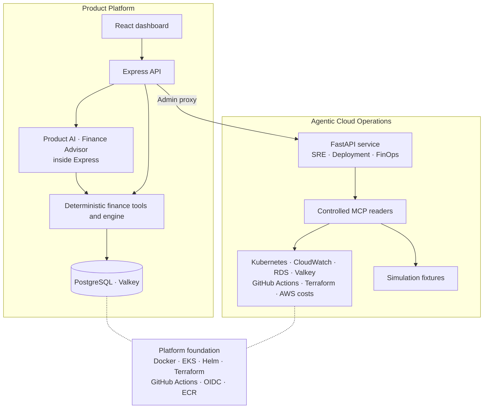
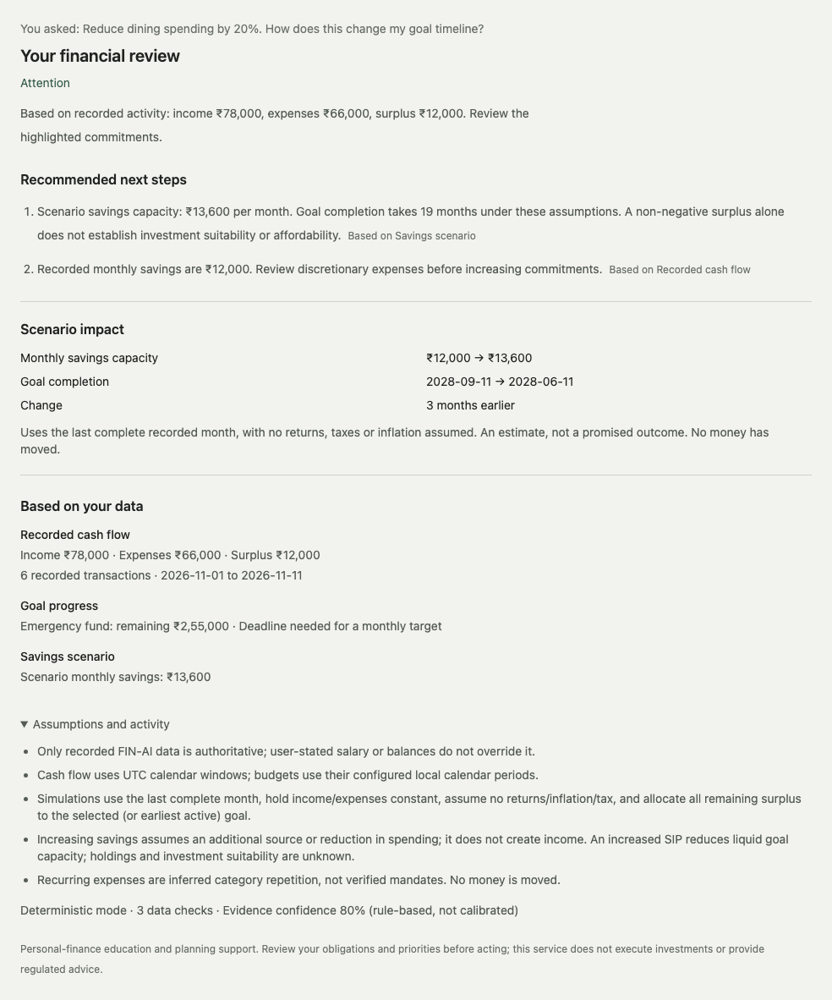
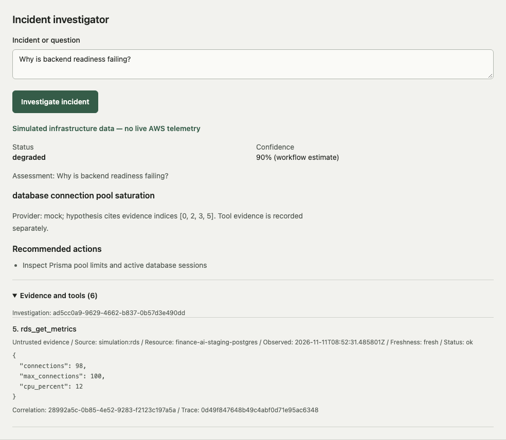
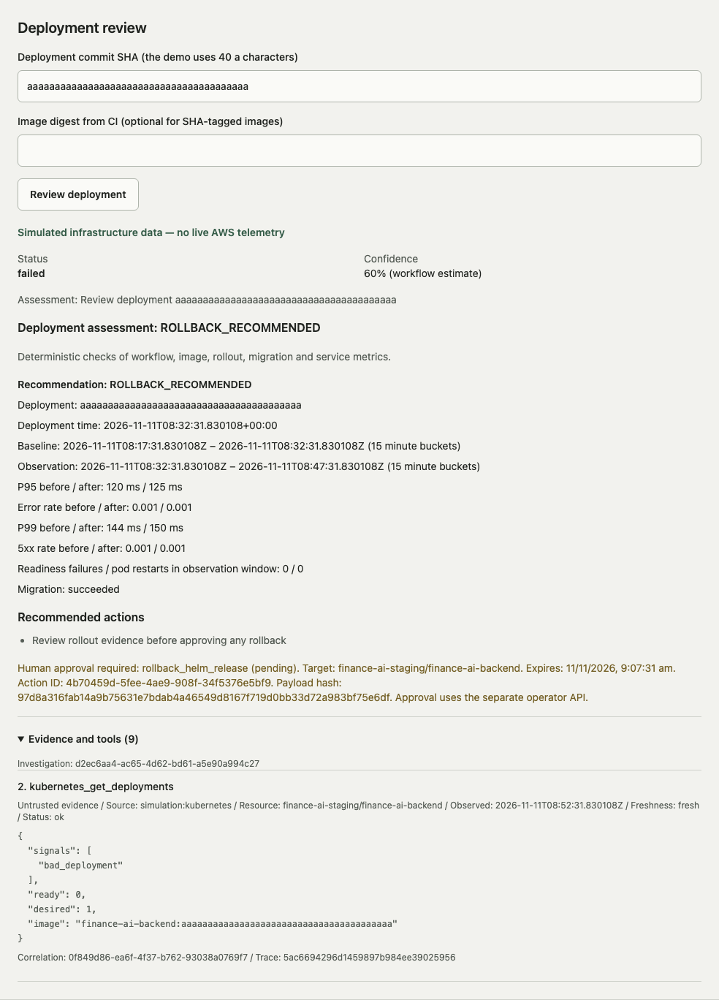

# FIN-AI

FIN-AI is a cloud-native personal finance platform with deterministic financial calculations, an evidence-backed Finance Advisor, and an operations service for incident diagnosis, deployment review, and FinOps.

| Layer                            | What it does                                                                                                                                            |
| -------------------------------- | ------------------------------------------------------------------------------------------------------------------------------------------------------- |
| **Product Platform**             | React dashboard and Express API for transactions, budgets, goals, and cash flow. PostgreSQL stores the ledger and Valkey supports runtime coordination. |
| **Product AI**                   | The Finance Advisor uses authenticated finance tools to explain recorded data and model savings scenarios.                                              |
| **Agentic Cloud Operations**     | A separate FastAPI service runs SRE, Deployment, and FinOps workflows through scoped MCP readers.                                                       |
| **Cloud / Platform Engineering** | Docker images, Terraform for AWS, Helm for EKS, and GitHub Actions with OIDC for image publishing.                                                      |

**Validation snapshot** · 22 Advisor and 24 Cloud Ops synthetic cases passed, along with hosted application, container, and agent checks. EKS is an on-demand deployment target. The local demo uses synthetic data and mock providers.

[Architecture](#architecture) · [Demo](#demo) · [Validated](#validated) · [Run locally](#local-development-and-demo) · [Interview guide](docs/INTERVIEW_GUIDE.md)

## Why this project is different

- **Deterministic money calculations.** The model chooses relevant tools and ranks findings. Application code calculates amounts and builds the response from validated evidence.
- **Scoped infrastructure access.** Cloud Ops collects evidence through read-only MCP tools with bounded inputs, timeouts, and provenance. The tool surface has no shell or unrestricted AWS access.
- **Explicit uncertainty and action boundaries.** Workflows can abstain when evidence is insufficient. IAM, Kubernetes RBAC, and the separate approval policy are enforced in code and infrastructure.
- **Reproducible behavior.** Fixtures exercise the same workflow contracts used by live readers. Both agents emit OpenTelemetry spans and metrics, and CI evaluates agent behavior alongside application tests.

## Architecture



## Demo

Click a screenshot for the full-size workspace. The Advisor ledger is synthetic, and both infrastructure screenshots are from Cloud Ops simulation mode.

| Finance Advisor                                                                                                                       | SRE investigation · simulation                                                                                                           | Deployment review · simulation                                                                                                               |
| ------------------------------------------------------------------------------------------------------------------------------------- | ---------------------------------------------------------------------------------------------------------------------------------------- | -------------------------------------------------------------------------------------------------------------------------------------------- |
| [](docs/assets/demo/finance-advisor.png) | [](docs/assets/demo/sre-investigation.png) | [](docs/assets/demo/deployment-review.png) |
| A 20% dining cut raises monthly savings capacity from ₹12,000 to ₹13,600 and brings the modeled goal forward three months.            | The workflow correlates readiness symptoms with connection pool saturation and suggests checks for the operator.                         | The workflow compares deployment-aligned metric windows and recommends rollback after a failed rollout.                                      |

Follow the [6½-minute demo script](docs/DEMO_SCRIPT.md) to reproduce the walkthrough.

## Product and Finance Advisor

The product tracks income and expenses, derives budget spending from transactions, and projects progress toward goals. Chat-assisted financial writes require confirmation. The read-only Advisor lives in the authenticated Express backend and uses user-scoped tools for cash flow, spending, budgets, goals, and educational knowledge. Its five simulations cover savings increases, category reductions, SIP increases, emergency expenses, and deadline changes. Results cite evidence and state their assumptions. See [Finance Advisor architecture and tool contracts](docs/FINANCE_ADVISOR_AGENT.md).

## Agentic Cloud Operations

The optional FastAPI service has three distinct workflows. **SRE** correlates infrastructure signals to diagnose incidents. **Deployment** checks the release and compares baseline and observation windows before recommending PROMOTE, HOLD, or ROLLBACK_RECOMMENDED. **FinOps** compares cost drivers and reports savings only when evidence supports an estimate. Helm disables the service by default. Live adapters require configured integrations, while simulation returns clearly labelled fixture evidence. Approval execution is simulation-only. See [Cloud Ops architecture, local setup, and policies](docs/AGENTIC_PLATFORM.md).

## Cloud and platform engineering

Terraform defines separate staging and production roots with private EKS workers, RDS PostgreSQL, ElastiCache Valkey, and encrypted S3 state. GitHub Actions builds and scans images, then publishes immutable product image tags to ECR on successful `main` pushes using OIDC. An operator supplies reviewed image references to Helm. A separate Prisma migration identity and pre-upgrade hook gate rollout, and `/livez` and `/readyz` distinguish process health from dependency readiness.

Application and platform visibility comes from structured logs, Kubernetes health checks, and AWS-managed telemetry when deployed. Separately, the Advisor and Cloud Ops instrument requests and tool calls with OpenTelemetry. Local export and telemetry privacy tests are documented in the agent validation reports. See the [Terraform roots](infra/terraform/README.md) and [Helm chart](deploy/helm/finance-ai/README.md).

## Validated

**Synthetic regression/evaluation results, not production accuracy claims.**

| System                                                  | Confirmed result                                                                                                                                                     |
| ------------------------------------------------------- | -------------------------------------------------------------------------------------------------------------------------------------------------------------------- |
| [Cloud Ops](docs/agent-evaluation.json)                 | 20 controlled MCP readers. 24/24 fixture outcomes: 15 diagnoses, 8 correct abstentions, and 1 healthy case. Zero unsafe actions and 5.38 mean tool calls.            |
| [Finance Advisor](docs/finance-advisor-evaluation.json) | 22/22 deterministic outcomes, including 5/5 simulations and 5/5 abstentions. Zero measured unsafe actions or hallucinated financial values and 2.82 mean tool calls. |

Hosted validation on merged `main` covered frontend type checking, tests and build, backend tests and PostgreSQL integration, browser smoke, Docker builds, Trivy, Gitleaks, dependency audits, and Helm/static Kubernetes checks. The Agent Platform run checked policy, MCP and PostgreSQL behavior, ran mock evaluations, scanned the agent image, and uploaded an SBOM. Terraform formatting, validation, and mock tests passed in the separate validation workflow. [Main CI](https://github.com/shashwat0912/FIN-AI/actions/runs/42204417711) · [Agent Platform](https://github.com/shashwat0912/FIN-AI/actions/runs/42204417784) · [Terraform validation](https://github.com/shashwat0912/FIN-AI/actions/runs/42107978249)

## Local development and demo

Use Node.js 20+, npm, and Docker. For Cloud Ops, add Python 3.12+ and follow the [simulation setup](docs/AGENTIC_PLATFORM.md#local-demonstration-without-aws).

```sh
npm ci
npm --prefix backend ci
cp -n backend/.env.example backend/.env
# Set development HMAC and CSRF secrets in backend/.env.
npm --prefix backend run db:generate
docker compose -f backend/docker-compose.yml up -d postgres redis
npm --prefix backend run db:migrate:deploy
npm run dev
```

Use `AI_PROVIDER=local`, `EMBEDDING_PROVIDER=local`, and `ADVISOR_PROVIDER=mock` in the backend for deterministic local use. The [demo script](docs/DEMO_SCRIPT.md#local-setup-and-screenshot-capture) describes the disposable PostgreSQL setup and Playwright capture.

## Security

Product authorization scopes finance reads to the signed-in user. Infrastructure requests go through the administrator-only proxy and a dedicated service identity. Live readers have dedicated IRSA and namespace-scoped RBAC. The operator approval API uses separate credentials and validates the action, target, payload hash, and expiry. Runtime and migration database roles are separated, TLS protects data-service connections, and deployment Secrets are supplied by reference. See the [security model](docs/SECURITY.md) and [agent policy details](docs/AGENTIC_PLATFORM.md).

## Limitations

The repository demonstrates a deployable architecture. Current verification covers local and hosted CI, including disposable Kubernetes checks. Live AWS integration and external OTLP export still require environment-specific validation. DNS, TLS, secrets, SMTP delivery, and Helm rollout require operator setup. Finance projections are educational, depend on recorded inputs and fixed assumptions, and perform no transactions. Production remediation executors are absent.

## Detailed documentation

| Path                                                                    | What to read                                                                                                                                                                                  |
| ----------------------------------------------------------------------- | --------------------------------------------------------------------------------------------------------------------------------------------------------------------------------------------- |
| [`frontend/`](frontend/) · [`backend/`](backend/)                       | Dashboard and Express API. See [product scope](PRODUCT.md) and [database setup](backend/DATABASE_SETUP.md).                                                                                   |
| [`backend/src/advisor/`](backend/src/advisor/)                          | [Advisor design](docs/FINANCE_ADVISOR_AGENT.md) and [validation](docs/FINANCE_ADVISOR_VALIDATION.md).                                                                                         |
| [`agent-service/`](agent-service/)                                      | [Cloud Ops design](docs/AGENTIC_PLATFORM.md) and [validation](docs/AGENTIC_VALIDATION.md).                                                                                                    |
| [`infra/terraform/`](infra/terraform/) · [`deploy/helm/`](deploy/helm/) | AWS definitions and chart. See the [public demo runbook](docs/PUBLIC_DEMO.md), [launch report](docs/LAUNCH_REPORT.md), and [EC2 to EKS migration](docs/architecture/legacy-ec2-migration.md). |
| [`docs/`](docs/)                                                        | [Demo script](docs/DEMO_SCRIPT.md), [interview guide](docs/INTERVIEW_GUIDE.md), and engineering records.                                                                                      |

No license has been selected. Standard copyright restrictions apply.
