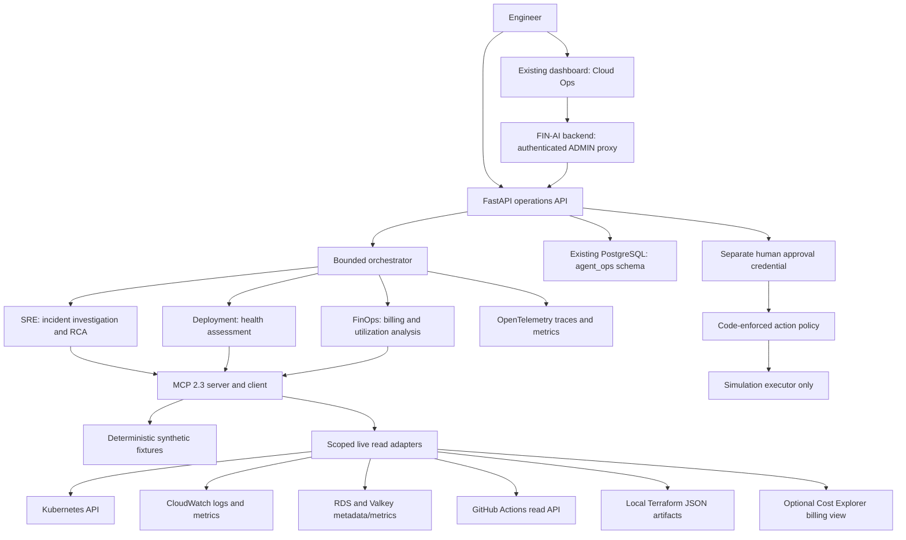

# FIN-AI Agentic Cloud Operations Platform

FIN-AI Product Platform **+** Agentic Cloud Operations Platform. FIN-AI remains the
workload: the finance application, PostgreSQL schema, Valkey integration, existing
infrastructure and release pipeline are preserved. The agent is an optional
operator service, disabled in Helm by default. No running AWS environment is
claimed, and implementing this feature does not deploy infrastructure.

## Architecture and responsibilities



One Python process hosts FastAPI and the official MCP SDK. Agents call tools over
the SDK's in-process protocol transport, including discovery, schemas and typed
structured results. There is no extra MCP network deployment. `python -m
app.mcp.server` also exposes the same reader tools over stdio for a trusted local
MCP host. Never expose this stdio process through an unauthenticated network bridge.

The three workflows do not invoke one another. SRE forms a fixed initial plan,
collects pod/deployment/event/log evidence, chooses a bounded follow-up plan from
symptoms, correlates evidence and emits an RCA. Deployment and FinOps use explicit
deterministic checks rather than an unnecessary LLM loop.

States are `received → planning → collecting_evidence → correlating_evidence →
completed/incomplete` (correlation state is explicit for SRE). Default limits:
14 tool calls, 8 seconds per tool, 60 seconds per investigation, four concurrent
investigations, eight concurrent read operations. Expiry/deadline failures retain
collected evidence and return `insufficient_evidence`; they do not trigger actions.
AWS socket deadlines and retries are also bounded. PostgreSQL statements and locks
have deadlines. Cancellation of a thread-backed AWS call may let that bounded read
finish in the background; it cannot perform a write.

## Local demonstration without AWS

Python 3.12+ is required. No AWS credentials, LLM key, Kubernetes cluster, or database
is needed for simulation. Use a virtual environment outside Git tracking:

```bash
python3 -m venv .venv
source .venv/bin/activate
pip install -r agent-service/requirements.lock -r agent-service/requirements-dev.lock
pip install --no-deps -e ./agent-service
export AGENT_DATA_MODE=simulation
export AGENT_LLM_PROVIDER=mock
export AGENT_WRITE_ACTIONS_ENABLED=false
export AGENT_API_TOKEN="$(python -c 'import secrets; print(secrets.token_urlsafe(32))')"
export AGENT_APPROVAL_TOKEN="$(python -c 'import secrets; print(secrets.token_urlsafe(32))')"
uvicorn app.api.main:app --host 127.0.0.1 --port 8000
```

In another terminal, use the same reader token (do not commit it):

```bash
curl -s http://127.0.0.1:8000/health
curl -s http://127.0.0.1:8000/ready
curl -s http://127.0.0.1:8000/api/v1/agent/investigate \
  -H "Authorization: Bearer $AGENT_API_TOKEN" -H 'Content-Type: application/json' \
  -d '{"incident":"Why is backend readiness failing?","scenario":"database_saturation"}'
curl -s http://127.0.0.1:8000/api/v1/agent/deployment-review \
  -H "Authorization: Bearer $AGENT_API_TOKEN" -H 'Content-Type: application/json' \
  -d '{"sha":"aaaaaaaaaaaaaaaaaaaaaaaaaaaaaaaaaaaaaaaa","scenario":"healthy"}'
curl -s http://127.0.0.1:8000/api/v1/agent/cost-analysis \
  -H "Authorization: Bearer $AGENT_API_TOKEN" -H 'Content-Type: application/json' \
  -d '{"scenario":"healthy"}'
```

Interactive API documentation is at `/docs` in simulation. Every tool and response
contains `data_mode`. The UI labels simulated infrastructure explicitly. Choosing
a scenario affects simulation only; live mode never falls back to fixtures.
Simulation records are ephemeral unless `AGENT_DATABASE_URL` is configured.
Readiness checks the configured record store; it does not assert all AWS
integrations are healthy. Missing live integrations return structured errors.

For the existing dashboard, start FIN-AI normally with these **backend-only** env
variables: `AGENT_SERVICE_URL=http://127.0.0.1:8000` and the same `AGENT_API_TOKEN`.
Use an existing local administrator account and open `/dashboard/cloud-ops`.
Ordinary finance users receive 403; an unconfigured agent returns 503. The existing
API client supplies FIN-AI authentication and CSRF handling. No agent/provider key
is bundled into frontend code. The proxy forwards only the three fixed read
workflows, never arbitrary tools or approvals.

## API and evidence

| Endpoint                                 | Authorization                  | Behavior                                       |
| ---------------------------------------- | ------------------------------ | ---------------------------------------------- |
| `GET /health`                            | None                           | Process health and data mode                   |
| `GET /ready`                             | None                           | Record-store readiness                         |
| `POST /api/v1/agent/investigate`         | Reader bearer token            | Typed incident + optional scenario             |
| `POST /api/v1/agent/deployment-review`   | Reader bearer token            | Commit SHA, optional CI image digest, scenario |
| `POST /api/v1/agent/cost-analysis`       | Reader bearer token            | Question and scenario                          |
| `POST /api/v1/agent/remediation/approve` | Separate approver bearer token | Approve one existing, immutable action ID      |

Pydantic rejects extra fields, invalid identifiers, oversized questions and unsafe
replica counts. POST bodies are limited to 16 KB. Validation errors omit submitted
input values. Tool results contain tool name, data mode, correlation UUID, trace
ID, duration, projected data, and an optional structured error. Error codes include
`DENIED`, `INVALID_INPUT`, `TIMEOUT`, and `UNAVAILABLE`. Investigation budget
exhaustion terminates the workflow with an incomplete result.

`evidence` contains tool observations; `reasoning` and `likely_root_cause` contain
provider/workflow interpretation. SRE exposes cited evidence indices in
`summary.evidence_ids`. Confidence is a workflow estimate, not a calibrated
probability. The mock provider is a deterministic diagnostic baseline matching
recognized evidence signals; it is not a trained general-purpose reasoning model.
Expected evaluation answers and scenario identifiers never enter its inference
context. No evidence means no supported RCA or automatic remediation.

Deployment checks workflow outcome, matching requested SHA, image tag/digest,
rollout replicas, pod readiness/images, migration job status, error signals, P95
and error-rate changes. Missing evidence yields HOLD; explicit failures or
regressions yield ROLLBACK_RECOMMENDED; complete healthy evidence yields PROMOTE.
GitHub deployment metadata is collected when the repository publishes it; absence
is visible and does not invent deployment records. A supplied `image_digest` supports the existing immutable production images;
its SHA-to-digest provenance is supplied by CI/operator and is **not independently
attested**. Live metric windows are the two latest complete 15-minute buckets, not automatically
aligned with deployment time. Neither the assessment nor CI automatically rolls
back or promotes a deployment.

FinOps compares two 30-day billing periods, reports measured service totals and
increases, and checks available RDS/Valkey utilization for idle candidates. It
covers EKS, EC2, RDS, Valkey, load balancing, CloudWatch and ECR when those services
appear in the configured billing view. Cost Explorer groups by service and usage type; `NatGateway` usage types
are separated from EC2 - Other as NAT Gateway spend. Short sampled utilization does not
justify resizing; estimated savings remain null until sufficient pricing and
utilization evidence exists. It never deletes resources.

## MCP reader tools

All exposed tools have the code-enforced `READ_ONLY` classification:

- `kubernetes_get_pods`, `kubernetes_get_deployments`, `kubernetes_get_events`,
  `kubernetes_get_pod_logs`, `kubernetes_get_ingress`,
  `kubernetes_get_resource_usage`, `kubernetes_get_migration_status`
- `cloudwatch_search_logs`, `cloudwatch_get_metric`, `cloudwatch_get_recent_alarms`
- `rds_get_health`, `rds_get_metrics`
- `valkey_get_health`, `valkey_get_metrics`
- `github_get_recent_workflow_runs`, `github_get_workflow_jobs`,
  `github_get_deployment_metadata`
- `terraform_get_plan_summary`, `terraform_get_outputs`
- `cost_get_summary`

The runtime namespace/deployment are configured, not model-selectable. Kubernetes
reads use in-cluster CA verification and rotating ServiceAccount credentials.
Responses project diagnostic fields; they never return pod environment variables,
Kubernetes Secrets, database contents, RDS credentials or cache connection strings.
Raw log lines/event messages are converted to allowlisted diagnostic signals before
model context. Output is recursively redacted and size-bounded. GitHub integration
uses a fixed `api.github.com` host, configured repository and GET endpoints; use a
fine-grained token with **Actions: read**, **Deployments: read**, and normal repository Metadata: read.
No repository mutation is supported.
`AGENT_GITHUB_WORKFLOW_NAME=CI` restricts workflow evidence to the existing CI
workflow, so an unrelated successful workflow cannot mask a failed deployment.

Terraform tools read only operator-configured local `terraform show -json` and
`terraform output -json` files. They return action counts and only non-sensitive
`eks_cluster_name`, `environment`, `aws_region` outputs. Plan values and arbitrary
outputs never enter model context. Terraform artifacts themselves may contain
secrets; keep them in private files, not Git or shared volumes. The tools neither
invoke Terraform nor access remote state. Helm volume mounting for these optional
artifacts is not yet provided.

## Human approval and policies

Every name is classified outside the LLM: registered reader tools are READ_ONLY;
`restart_deployment`, `rollback_helm_release`, `scale_deployment` are
APPROVAL_REQUIRED; every other name is DENIED. There is no shell, generic command,
unrestricted HTTP tool, infrastructure delete, IAM mutation or Terraform apply.

SRE may propose a restart after grounded crash-loop evidence. Deployment may
propose a rollback after a failed/regressed deployment. Recommendations create
pending action records rather than executions. Scaling is supported by the typed,
bounded action framework and tests, but these workflows do not propose scaling
without capacity evidence. There is no public arbitrary action-creation endpoint.

To demonstrate approval, start the service with
`AGENT_DATA_MODE=simulation AGENT_WRITE_ACTIONS_ENABLED=true`, investigate the
`crash_loop` scenario, and approve the returned action ID using the separate token:

```bash
curl -s http://127.0.0.1:8000/api/v1/agent/remediation/approve \
  -H "Authorization: Bearer $AGENT_APPROVAL_TOKEN" -H 'Content-Type: application/json' \
  -d '{"action_id":"REPLACE_WITH_RETURNED_ACTION_UUID"}'
```

The approver credential differs from the reader credential. The approver identity
comes from `AGENT_APPROVER_ID` (default `local-operator`), never request body or log
text. Reader operations use the server's `investigation-operator` identity. These
are service/operator identities, not per-person SSO attribution. Actions bind the
investigation, configured target, requester, parameters and a 15-minute expiry.
Approval validates policy, environment, target and expiry, then atomically claims
the record. Duplicate/concurrent approval cannot claim it twice. Proposal,
approval/denial and simulation completion have audit records. The simulation
executor returns `simulated`; it does not pretend infrastructure changed.

`AGENT_WRITE_ACTIONS_ENABLED=false` is the default. **Live executors are absent,
even if that flag is true.** Helm also rejects live+write-enabled configuration.
A failed durable audit/claim stops execution; an interrupted `executing` record
requires operator inspection rather than retrying a possibly completed action.
A real executor, separate writer identity/RBAC, per-person OIDC approval and
rollback safeguards are future work, not production capabilities claimed here.

## PostgreSQL and Valkey

Live mode requires `AGENT_DATABASE_URL` pointing at the existing PostgreSQL
instance, using a dedicated role restricted to the `agent_ops` schema. The SQL in
`app/services/schema.sql` creates only agent records and an index; no Prisma
application tables or migrations are modified. Pre-provision the schema/objects
with a database administrator before handing the runtime role ownership of these
objects. Use TLS with verified CA settings appropriate to RDS. Startup uses
idempotent DDL and requires permissions on its own schema; do not reuse the
finance backend's application credentials or database admin role.

Simulation uses the same store interface in memory or can use PostgreSQL. Audit
and investigation records persist in PostgreSQL when configured. Retention and
immutable external audit archival are future work. Valkey remains the existing
FIN-AI dependency and an observed infrastructure target. No additional cache is
needed for this bounded request workflow, so the agent has no Valkey credentials
or dependency on cache availability for approvals.

## IAM, RBAC and Helm

`agentService.enabled: false` preserves the original chart rendering. Enabled
simulation has a dedicated ServiceAccount with token automount disabled and no
RBAC grants. Live mode mounts only that identity's Kubernetes token and creates a
namespaced reader Role/RoleBinding with `get,list` on pods, pods/log, events,
services, deployments, replicasets, ingresses, metrics pods and migration jobs.
No Secrets, exec, cluster-scoped grants, write Role or cluster-admin exists.
Namespace listing permissions cannot enforce pod-label authorization; use a
namespace dedicated to FIN-AI. Backend and agent identities remain separate.

The Deployment has non-root UID 10001, read-only root filesystem, dropped
capabilities, RuntimeDefault seccomp, bounded `/tmp`, resources, probes and a
ClusterIP Service. Ingress NetworkPolicy accepts the existing release's backend
pods only; enforcement requires a NetworkPolicy-capable CNI. The agent receives
no public Ingress route. Existing frontend/backend ingress behavior is preserved.

Create a separate `finance-ai-agent-secrets` Secret externally. Expected keys are
`AGENT_API_TOKEN`, optional `AGENT_APPROVAL_TOKEN`, `AGENT_DATABASE_URL`,
`OPENAI_API_KEY`, `AGENT_GITHUB_TOKEN` as applicable. The backend references only
its reader token key. Secret values are forbidden in agent ConfigMap values.
Supply live identifiers through the agent config, and configure
`agentService.serviceAccount.annotations.eks.amazonaws.com/role-arn` explicitly.

Terraform's new `agent-irsa` module is opt-in through `agent_enabled=false` in
staging/production. Enabling it requires an existing backend log group ARN; it
creates only a dedicated role/policy when an operator later applies it. It creates
no databases, clusters, log groups or billing views. No apply was part of this work.
Trust uses the exact EKS OIDC provider, audience `sts.amazonaws.com`, namespace
(`finance-ai-staging` or `finance-ai`) and ServiceAccount `finance-ai-agent`.

| Permission                              | Resource boundary                            | Reason                                                                                     |
| --------------------------------------- | -------------------------------------------- | ------------------------------------------------------------------------------------------ |
| `logs:FilterLogEvents`                  | Selected backend log group ARN and streams   | Extract recent diagnostic signatures                                                       |
| `cloudwatch:GetMetricStatistics`        | `*`                                          | AWS action does not support resource-level authorization; code fixes namespaces/dimensions |
| `cloudwatch:DescribeAlarms`             | FIN-AI alarm ARN prefix                      | Recent metric alarm state, no composite-alarm requirement                                  |
| `rds:DescribeDBInstances`               | FIN-AI DB instance ARN                       | Health state only, no credentials returned                                                 |
| `elasticache:DescribeReplicationGroups` | FIN-AI replication group ARN                 | Health state only                                                                          |
| `ce:GetCostAndUsage`                    | Explicit existing billing view ARN, optional | Read bounded billing comparison                                                            |

No wildcard action exists. No EKS AWS API permission is needed: cluster evidence
comes from the Kubernetes API with independent RBAC. Cost Explorer is disabled
unless both `AGENT_COST_EXPLORER_ENABLED=true` and `AGENT_BILLING_VIEW_ARN` are set;
Terraform grants it only when `agent_billing_view_arn` is supplied. Billing scope
must be reviewed: a billing view may contain resources beyond FIN-AI.

IAM references: [CloudWatch](https://docs.aws.amazon.com/AmazonCloudWatch/latest/monitoring/permissions-reference-cw.html),
[RDS](https://docs.aws.amazon.com/service-authorization/latest/reference/list_rds.html),
[ElastiCache](https://docs.aws.amazon.com/service-authorization/latest/reference/list_elasticache.html),
[Cost Explorer billing views](https://docs.aws.amazon.com/service-authorization/latest/reference/list_ce.html).

## Providers and OpenTelemetry

`AGENT_LLM_PROVIDER=mock` is the default and is forced in CI/evaluation. SRE can
use `openai` with a backend-only `OPENAI_API_KEY` and configurable
`AGENT_OPENAI_MODEL`. The adapter uses structured Pydantic output, validates
citations against successful evidence, sends no tool definitions and has one
bounded retry, 15-second provider timeout, 12,000-character context bound and
800-output-token default. Provider failure produces incomplete evidence, not an
invented diagnosis. No paid call was used for verification; the OpenAI contract is
mock-tested. See [official structured output guidance](https://developers.openai.com/api/docs/guides/structured-outputs)
and [MCP SDK client transports](https://py.sdk.modelcontextprotocol.io/client/).

`AGENT_TELEMETRY_EXPORTER=none|console|otlp` configures trace and metric exporters.
For OTLP/HTTP use `AGENT_OTLP_ENDPOINT=http://collector:4318` (base URL, no trailing
slash). No collector is introduced. Traces include `incident_investigation`,
`create_plan`, each named tool, `correlate_evidence`, `generate_rca`, deployment/cost
workflows and simulated remediation. Only fixed names, data mode, status and error
codes enter span attributes; prompts, log bodies and credentials do not.

Metrics are `agent_requests_total`, `agent_request_duration` (seconds),
`tool_calls_total`, `tool_call_duration` (seconds), `tool_failures_total`,
`agent_tokens_used`, `estimated_llm_cost` (USD), `investigation_steps`,
`human_approval_requests`, `human_approval_accepts`. Mock tokens/cost are zero.
Configure `AGENT_LLM_INPUT_USD_PER_MILLION` and
`AGENT_LLM_OUTPUT_USD_PER_MILLION` for cost estimates; unset pricing emits zero
with `pricing_configured=false`, not a claim of free paid inference. Logs/audit
records include correlation/trace identifiers; external exporters can connect tool
latency to investigations. Metrics intentionally avoid incident IDs as labels.

## Evaluations and verification

```bash
pytest agent-service/tests
cd agent-service && python -m app.evals.run
```

The fixture suite covers CrashLoopBackOff, OOMKilled, PostgreSQL unavailable,
connection saturation, Valkey unavailable, invalid environment, failed Prisma
migration, unhealthy ALB targets, latency regression, bad rollout, failed GitHub
Actions and expired/missing configuration. Healthy fixture data is shared; scenario
files contain only changed observations plus evaluation expectations. Agents read
merged tool observations; the runner alone reads expected answers and forbidden
actions. Tests also cover empty evidence, provider failure, deadlines, tool budget,
secret reduction, denied operations, API credentials, replay/concurrent approval,
PostgreSQL CAS and OpenTelemetry span payloads.

The runner measures exact RCA match, required successful tool coverage, required
tool selection, forbidden proposed actions, calls beyond the scenario minimum and
investigation steps. Extra calls are a conservative overhead proxy, not proof each
call was useless. Unsafe-action count is zero in these read workflows; separate
negative tests exercise denied and unapproved actions. These synthetic cases are
not held-out production incidents or an LLM accuracy benchmark. Do not extrapolate
100% fixture accuracy to live incidents. Actual results and verification status are
recorded in [AGENTIC_VALIDATION.md](AGENTIC_VALIDATION.md) and
[agent-evaluation.json](agent-evaluation.json).

The additive `Agent Platform` GitHub Actions workflow installs locked dependencies,
checks formatting/lint/types, runs tests against an isolated PostgreSQL service,
executes the evaluation, uploads its real result, checks optional Helm rendering,
builds the agent image and applies the existing HIGH/CRITICAL Trivy threshold.
Existing FIN-AI CI/security jobs are unchanged. The agent job has no deploy, push,
AWS credential or paid-model step. Configure branch protection to require the new
check after review. No automated post-deploy invocation has been added to the
existing release workflow; callers can invoke the deployment-review API explicitly.

The Dockerfile pins Python by version and digest, applies Debian security fixes,
uses a shared minimal base and separate builder/runtime stages, installs locked
runtime dependencies and runs non-root with a healthcheck. Development test/lint
dependencies are absent from the runtime.

## Remaining validation and truthful scope

Live AWS, EKS RBAC/IRSA authorization, real log/metric dimensions, GitHub token
permissions, real billing scope, and an external OTLP collector need a deliberately
enabled environment. The current adapters can return insufficient evidence if FIN-AI
does not emit `FinanceAI/RequestDurationMs` and `ErrorRate` with the configured
`Service` dimension; this feature does not pretend those metrics already exist.
Set `AGENT_ALB_DIMENSION` and `AGENT_TARGET_GROUP_DIMENSION` to enable scoped
ALB unhealthy-target metrics. Valkey metrics depend on the deployment's actual CloudWatch dimensions. Kubernetes
metrics-server must exist for resource usage. No live environment was started.

Future work: live action executors and separate writer identity, individual OIDC
approval, attested image provenance, deployment-aligned metrics, sustained idle-resource analysis, audit retention, external
OTLP validation, and a
post-deploy workflow callback. None is required for the deterministic local demo;
none is claimed as implemented production capability.
