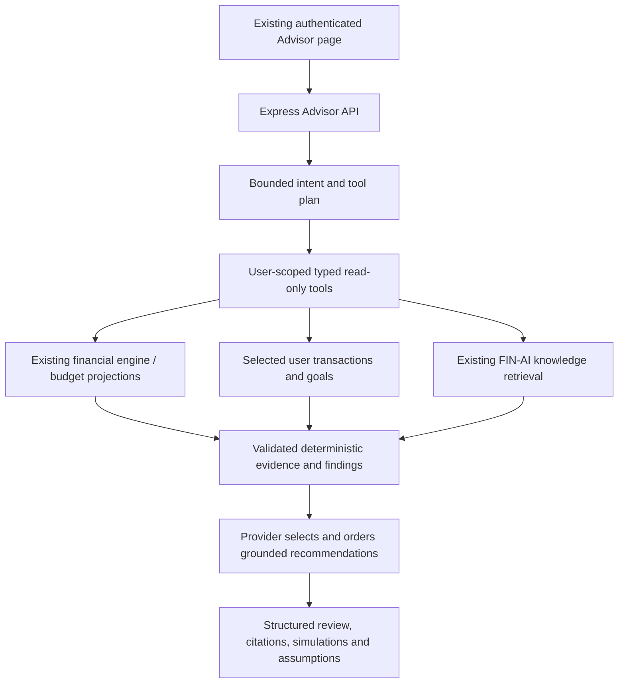

# Finance Advisor Agent

FIN-AI's existing Advisor page now calls `POST /api/v1/advisor`. The existing
chat, V1 insight and legacy AI endpoints remain available. Cloud Ops remains
unchanged. This is personal-finance education/planning support, not regulated
investment, tax or legal advice, and never an executor of financial decisions.



## Implementation boundary

The implementation belongs in the TypeScript product backend so it can reuse
existing services and authentication directly. The Python Cloud Ops provider is
in a separately deployed, infrastructure-privileged service; sharing it would
unnecessarily move personal finance data across that boundary. No extra service,
database, vector store or major agent was added.

The model interprets intent, selects tools, extracts explicit scenario parameters,
and selects/orders up to three validated findings for the question. The backend
renders their evidence-linked explanations. OpenAI does **not** supply new financial
amounts, formulas, recommendation prose or confidence scores. This deliberately
constrained synthesis prevents invented numbers from reaching the answer. It is
not a free-form financial chatbot. Deterministic mode uses the same workflow,
tools, findings and response contract with a small intent parser.

The existing V1 engine computes cash flow; it now accepts optional explicit date
windows and an optional read-only transaction client. Existing callers retain
their behavior. The existing budget projection service similarly accepts an
optional client, preserving its timezone/category/Decimal behavior. New goal and
scenario calculations live in `financeSimulationService`, outside the provider.

## Tools and evidence

| Tool                       | Purpose                                                                                                     |
| -------------------------- | ----------------------------------------------------------------------------------------------------------- |
| `get_financial_summary`    | Recorded month-to-date income, expenses, net cash flow and savings rate; no overlapping cashflow tool       |
| `get_budget_status`        | Existing category projections, remaining budget and period metadata; unmapped categories explicitly flagged |
| `get_goal_progress`        | Active goal balances, remaining amount, deadline and required monthly contribution                          |
| `get_spending_trends`      | Matched elapsed-time windows versus the prior month; limited history marked non-comparable                  |
| `get_category_breakdown`   | Full normalized current-period category aggregates                                                          |
| `get_recurring_expenses`   | Repeated subscription/rent/utility/mobile categories in the last two complete months, explicitly inferred   |
| `get_recent_transactions`  | At most ten recent amounts, canonical categories, types and dates; no descriptions or user/session records  |
| `simulate_savings_plan`    | Increased savings, reduced category spend, increased SIP or a one-time emergency expense                    |
| `simulate_goal_change`     | Shift a selected goal deadline and recompute its monthly requirement                                        |
| `search_finance_knowledge` | Up to three educational excerpts from the existing knowledge layer, using local keyword retrieval           |

Tool input/output contracts and runtime Joi validation reject unknown fields,
unsupported tools, non-finite values and oversized output. Each result records
tool, source, observation time, status and evidence ID. Failures expose only
fixed error codes. Recommendations cite these IDs. Raw SQL/HTTP/shell tools and
financial write operations do not exist.

The authenticated backend binds the tool session's user ID; request/model-supplied
user identities are never accepted. Every personal query filters by that ID.
Explicit goal IDs resolve only within the user's own active goals. Database reads
use read-only repeatable-read transactions, 2.5-second SQL statement deadlines,
3-second transaction deadlines and bounded lists. Exceeding a complete-list limit
fails instead of returning a falsely complete answer. Knowledge retrieval is
non-personal, bounded to 100 candidates/three results, and has a response deadline;
its existing Prisma read is not driver-cancelled when the response times out.

## Deterministic simulations

Examples in the UI or question parser:

- Increase monthly savings by ₹3,000.
- Reduce dining spending by 20% (the API also accepts other supported categories).
- Increase SIP by ₹5,000: subtract this from liquid goal capacity; no investment
  returns or holdings are invented.
- Add ₹50,000 of emergency expense: add a one-time funding need to the selected goal.
- Move the goal deadline six months later or earlier.

The API accepts explicit `simulation` parameters with validated amounts,
percentages, canonical categories and optional goal ID. The form provides the
same controls for dining reduction and the other scenario kinds, plus a selector
for the account’s active goals. Explicit form
parameters override model extraction. Without a goal ID the earliest active
incomplete goal is selected; the API supports selecting another owned goal.

Baseline capacity is the **last complete UTC calendar month's recorded surplus**,
requiring recorded income and at least three transactions. A projection assumes
this surplus continues and is allocated entirely to **one** goal. It does not
allocate the same surplus to multiple goals simultaneously. Goal status compares
each goal independently under that assumption. Contribution counts are rounded
up; required monthly amounts are rounded up to the next paisa. Deadline analysis
counts complete monthly contribution periods; a deadline before the next period
cannot be promised. Completion dates use monthly steps; estimates beyond 100 years
omit a date. Zero/negative surplus produces no finite completion estimate.

Extra savings must come from an actual spending reduction or new funds; a scenario
does not create income. Emergency expense funding does not imply an available
bank balance or automatically borrow money. No interest, taxes, inflation, future
salary, trading return or securities suitability is assumed. No account data is
modified. Positive remaining surplus is **not** an investment recommendation or
proof of affordability. Net worth and verified mandates are unsupported because
the current data model does not establish them.

Cash flow uses UTC periods; budget evidence retains the user's existing timezone
periods. Trend windows clamp to the prior month's end when month lengths differ;
compare the displayed windows rather than assuming equal coverage. All conclusions
are about recorded data, not a complete picture of assets, debt or future bills.
The 20% savings threshold is a simple review heuristic, not a regulated health score.

## Providers, context and limits

Default `ADVISOR_PROVIDER=mock` needs no API key. Set `ADVISOR_PROVIDER=openai`,
`OPENAI_API_KEY` and optionally `ADVISOR_OPENAI_MODEL` to use the existing server-side
OpenAI SDK. No frontend key or paid CI call is introduced. OpenTelemetry uses versions
2.12/0.223 to support the existing Node 20 CI; the backend production image
retains Node 22. Model refusal, invalid
JSON/citations, budget overflow and provider failures fall back to deterministic
planning/selection. Missing credentials in explicitly configured OpenAI mode may
return a generic unavailable response; configuration must be validated before use.

Hard limits per request: six tools, two model calls, zero SDK retries, 8,000 UTF-8
bytes per model input (a conservative token bound), 600 output tokens per call,
6-second SDK call timeout/6.5-second response deadline, 3.5-second tool response
deadline, 25-second overall deadline, 1,200-character question and 24 KB per tool
result. Timeout stops further investigation; incomplete evidence yields an
insufficient-evidence answer rather than a health assurance. No autonomous loop.
The existing authenticated chat limiter and global security/CSRF gates apply.

A review stays in component memory and is replaced by the next review or cleared
on navigation. No new conversation database, localStorage financial cache or
long-term memory is added. Each question reconstructs authoritative context;
follow-ups should restate the scenario or use the form. Existing saved AI history
remains readable in an expandable section, under its existing retention behavior.

## Safety and knowledge

User salary claims never override transaction totals. Evidence cannot be hidden
by a prompt instruction. Tools cannot transfer funds, trade or mutate financial
records, regardless of user/model instructions. Execution/guarantee/tax-certainty
requests are refused with no tool execution. Unknown questions/data and missing
knowledge return explicit unsupported/insufficient-evidence responses.

Retrieved text is untrusted educational material, separated from personal data.
Credential patterns are redacted; descriptions, emails, sessions and credentials
are not selected into personal tool outputs. Educational excerpts carry source
citations and a dated-material caveat. FIN-AI's existing corpus includes dated
regulatory/rate claims: it does **not** establish current rules, tax liability or
financial suitability. No live web/regulatory refresh is implemented. Curated,
dated primary-source ingestion is needed before stronger educational claims.

## OpenTelemetry

`ADVISOR_TELEMETRY=none` is default. `console` exports manual spans/metrics locally;
`otlp` uses the Node SDK's standard `OTEL_*` configuration, for example an operator-
supplied OTLP endpoint and service name. No auto instrumentation or environment/
process resource detection is enabled. Shutdown flushes telemetry through the
existing backend shutdown coordinator.

Manual request/tool spans contain fixed operation names and status. Metrics:
`advisor_requests_total`, `advisor_request_duration`, `advisor_tool_calls`,
`advisor_tool_failures`, `advisor_tokens`, `advisor_estimated_cost`,
`advisor_abstentions`, `advisor_simulations`. Labels contain only registered tool,
input/output direction or fixed abstention reason. Prompts, SQL, IDs, amounts,
transaction narratives, raw knowledge and exception messages are excluded.
Exported-span and metric tests inject sensitive markers, including exception paths.
Mock usage/cost is zero; OpenAI usage comes from SDK usage metadata. Dollar estimates
are emitted only if both operator-supplied per-million-token prices are valid;
without them cost is unknown, not an asserted zero. Aborted/failed paid requests
may be billable without returning usage metadata. No hard dollar-budget claim.

## Evaluation and verification

Run from the repository root:

```sh
npm --prefix backend run test:ci
npm --prefix backend run --silent advisor:eval
# For actual authorization/query checks, use the guarded isolated test database:
npm --prefix backend run test:integration
npm run test:run
```

The evaluator uses independent synthetic inputs/expected statuses, required tools,
expected recommendation IDs and hand-calculated simulation values. It does not
score model wording. Results report tool selection, evidence/financial-data
consistency, recommendation relevance, simulation correctness, citation coverage,
hallucination/unsafe-action counts, abstention and tool calls. Non-simulation cases
are excluded from the simulation denominator. This is a deterministic regression
suite, not evidence of live-model accuracy or real financial-advice quality.

Scenarios: healthy finances, one/multiple budget overruns, low savings, goals
behind/ahead, recurring subscriptions, spending spike, insufficient history,
missing budget, conflicting salary assumption, increased savings, dining reduction,
knowledge retrieval/abstention, ignore-app-data injection, suppress-evidence
injection, transfer denial, guaranteed-return denial, SIP increase, emergency
expense and deadline shift. Additional tests cover schema/credential handling,
provider failures/refusals/limits, output poisoning, timeouts, exact decimals,
non-positive surplus, expired/completed goals, exported telemetry and actual
PostgreSQL/API ownership isolation. Automated runs force deterministic providers
and local retrieval; SDK provider tests mock network responses.

CI runs the advisor suites through existing unit/integration/UI jobs and adds a
separate deterministic eval step and JSON artifact. Existing type, build, secret,
runtime dependency, filesystem and image security gates remain unchanged.
Machine-generated results are in [finance-advisor-evaluation.json](finance-advisor-evaluation.json).
Executed verification and the exact file inventory are recorded in
[FINANCE_ADVISOR_VALIDATION.md](FINANCE_ADVISOR_VALIDATION.md).

## Remaining validation and truthful scope

Live paid-model intent selection, extraction, refusal/fallback quality, measured
latency/token billing and external OTLP still require controlled validation.
Production data/scale, localized month boundaries and data completeness need
product review. No paid calls, AWS resource creation, Terraform apply, live
remediation, deployment, merge or production financial action is part of this task.

A truthful resume claim: “Implemented a user-scoped finance planning agent around
deterministic financial tools, with evidence-linked recommendations, Decimal
scenario simulation, bounded mock/OpenAI orchestration, OpenTelemetry privacy
checks and synthetic/adversarial evaluation.” Do not claim regulated advice,
autonomous investing, production recommendation accuracy or guaranteed outcomes.
